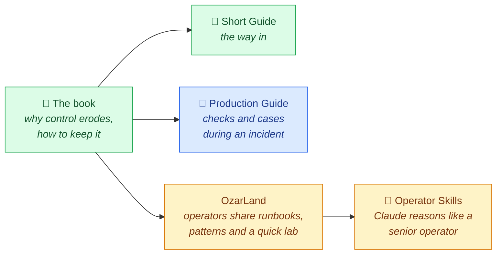

# Soufian Zaouam

**OpenStack in production — Day-2 operations, stability and governance of mission-critical private cloud platforms.**

*Deployment is where the operational journey begins.*

---

🛠️ I have worked on OpenStack platforms since 2016 and, for more than five years, on their operation in production:
deployment and administration, incident management, monitoring and log management, upgrades, and the organisation
that has to exist around a platform once a business depends on it. As a consultant, I have carried out these
missions for banks and public administrations in France.

🎯 My interest is less in getting OpenStack to work than in keeping it under control afterwards — visibility,
stability, recoverability, and the decisions that preserve them.

## 🗺️ How my public work fits together

## 📚 Public work

| | What it is | Read it for |
| --- | --- | --- |
| 📘 **[OpenStack, the Day After Tomorrow](https://github.com/soufian-zaouam/openstack-the-day-after-tomorrow)** | Free book (PDF, 116 pages, 20 chapters, CC BY-NC-ND 4.0) | The reasoning: why control over a platform erodes, how to assess it, how to keep it while the platform, its workloads and its people change |
| 📗 **[Short Guide](https://github.com/soufian-zaouam/openstack-the-day-after-tomorrow-guide)** | The book's ideas in 18 illustrated pages | A first read, or a shared reference for managers, sponsors and platform leads |
| 🚨 **[OpenStack Production Guide](https://github.com/soufian-zaouam/openstack-production-guide)** | Troubleshooting by symptom, command and error message; the *One Command, One Investigation* series (20 episodes); six anonymised incident RCAs; change and rollback methodology | The practice, during an incident |

The book explains *why*; the Production Guide gives the checks, commands and cases for *when it is already
happening*; the Short Guide is the way in.

## OzarLand

**[OzarLand](https://github.com/OzarLand)** is the open community I started in October 2026: an early-stage,
independent space where OpenStack operators share what they learn running it. Every page names its source and says
how much it was checked.

| | Repository | What it holds |
|:-:|---|---|
| | [ozarland](https://github.com/OzarLand/ozarland) | Start here: newcomer path, community rules, Discussions |
| 🔧 | [openstack-vm-runbooks](https://github.com/OzarLand/openstack-vm-runbooks) | Symptom-driven runbooks for instance problems |
| 🏗️ | [kolla-ansible-deployment-patterns](https://github.com/OzarLand/kolla-ansible-deployment-patterns) | How platforms are deployed with Kolla-Ansible, and what each choice implies |
| 🧪 | [openstack-quick-lab](https://github.com/OzarLand/openstack-quick-lab) | A disposable all-in-one OpenStack on one VM, with exercises |
| 🤖 | [openstack-operator-skills](https://github.com/OzarLand/openstack-operator-skills) | Claude Agent Skills for incidents, changes, maintenance and troubleshooting, with the validation status of every procedure |

## 🧰 Areas of work

**OpenStack in production** — deployment and administration with Kolla-Ansible; Day-2 operations, incident and
problem management, recovery, upgrades and lifecycle

**Observability** — log management and correlation for production platforms

**Platform foundations**

**Languages**

<b>Earlier work</b>

Cloud Foundry / BOSH on OpenStack, Kubernetes on IBM Cloud, Elasticsearch cluster engineering

## 🎓 Background

| | |
|:-:|---|
| 🎓 | Master's degree in computer science (data analysis and optimisation), University of Caen Normandy, 2016 |
| 🎓 | Bachelor's degree in computer science (software development), University of Caen Normandy, 2014 |
| 🌍 | Arabic, English, French |

## 📬 Contact

- 💼 Professional enquiries: [LinkedIn](https://www.linkedin.com/in/soufian-zaouam)
- 📝 Questions, corrections and suggestions about the book or the guides: open an issue in the corresponding repository
- OpenStack questions and field reports: [OzarLand Discussions](https://github.com/OzarLand/ozarland/discussions)
